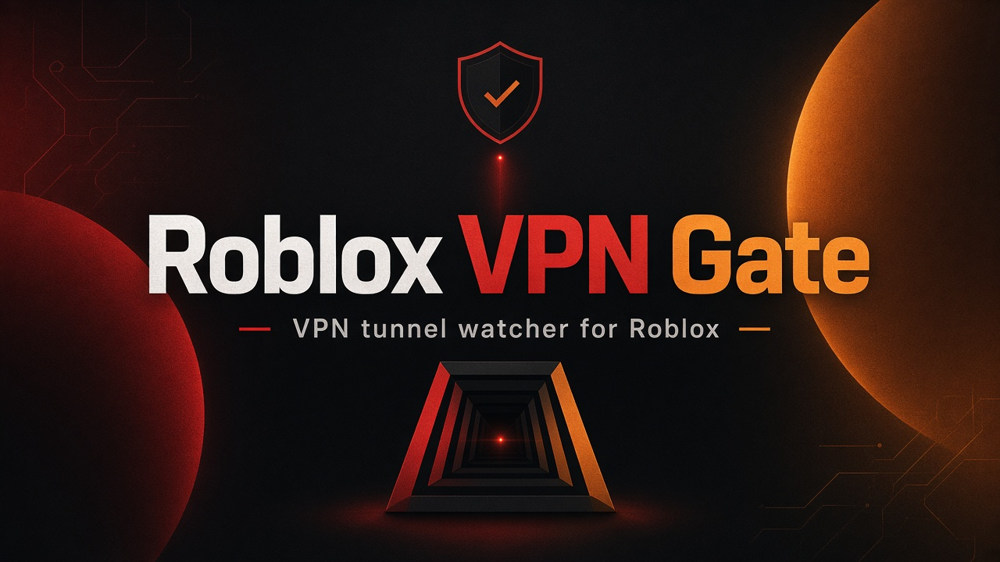
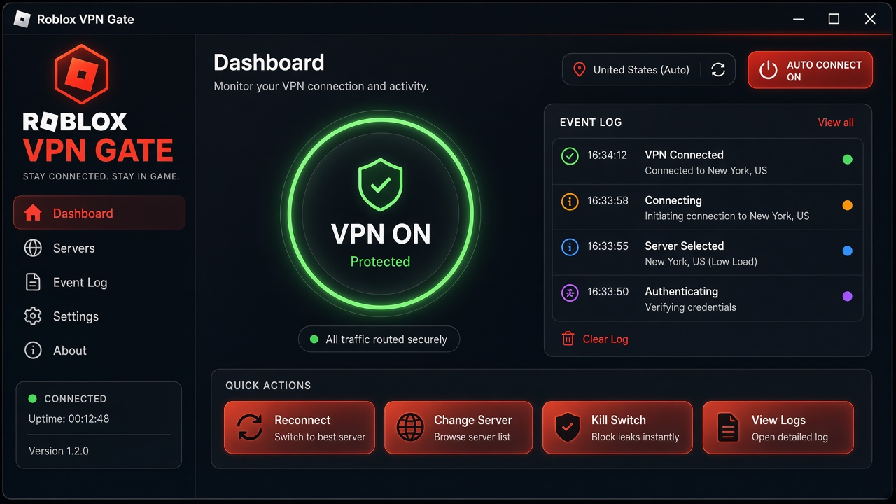
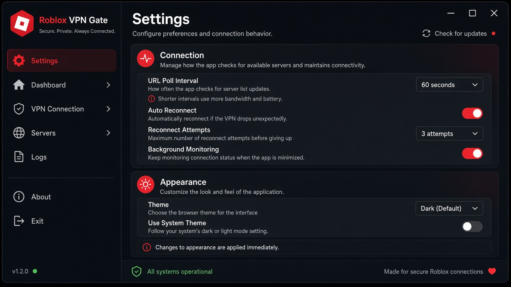

<p align="center">
  
</p>

<p align="center">
  <strong>Roblox VPN Gate</strong> — открывает вкладку Roblox при <em>реальном</em> подключении VPN и сразу закрывает её, когда туннель падает.<br/>
  Красивый HTML-интерфейс · настройки · мониторинг адаптеров Windows
</p>

<p align="center">
  <a href="#-быстрый-старт"></a>
  <a href="README_EN.md"></a>
  
  
  
</p>

<p align="center">
  <b>🇷🇺 Русский</b> · <a href="README_EN.md">🇬🇧 English</a>
</p>

---

## Зачем это

Многие «VPN-автоматизации» смотрят только на то, **запущен ли процесс** клиента.  
Roblox VPN Gate смотрит на другое: **поднялся ли сетевой VPN-интерфейс / RAS-туннель**.

| Событие | Действие |
| --- | --- |
| VPN-адаптер стал `UP` | Открывает вкладку с нужным URL (по умолчанию `roblox.com`) |
| VPN-туннель отключился | Сразу закрывает эту вкладку |
| Клиент VPN открыт, но туннеля нет | Ничего не делает |

Поддерживаются типичные туннели: WireGuard / WinTun, OpenVPN TAP, NordLynx, WARP, Mullvad, корпоративные RAS (SSTP/L2TP/IKEv2) и другие по ключевым словам.

---

## Скриншоты

<p align="center">
  
</p>
<p align="center"><i>Панель статуса: кольцо VPN, быстрые действия, журнал событий</i></p>

<p align="center">
  
</p>
<p align="center"><i>Настройки: URL, браузер, интервал опроса, темы, ключевые слова адаптеров</i></p>

---

## Возможности

- Детект **подключения**, а не окна VPN-программы
- HTML UI: темы *Midnight Arena*, *Ember Forge*, *Ice Tunnel*
- RU / EN переключатель прямо в приложении
- Настройки URL, Chrome/Edge, интервал опроса, ignore-листы
- Ручное открытие/закрытие вкладки
- Список всех сетевых адаптеров Windows

---

## Быстрый старт

### Требования

- Windows 10 / 11
- Python 3.10+
- Google Chrome **или** Microsoft Edge

### Установка

```bat
git clone https://github.com/ZVatnikV/RobloxVPNGate.git
cd RobloxVPNGate
run.bat
```

Или вручную:

```bat
py -3 -m venv .venv
.venv\Scripts\activate
pip install -r requirements.txt
python main.py
```

При первом запуске Selenium скачает подходящий webdriver автоматически.

---

## Как пользоваться

1. Запустите приложение через `run.bat`.
2. Нажмите **Запустить мониторинг** (или включите автозапуск в настройках).
3. Подключите VPN как обычно.
4. Когда туннель станет активным — откроется вкладка Roblox.
5. Отключите VPN — вкладка закроется сразу.

> Уже активный VPN при старте мониторинга **не** открывает вкладку повторно. Срабатывает именно переход *offline → online*.

---

## Настройки

Файл `settings.json` создаётся автоматически из `settings.default.json`.

| Параметр | Описание |
| --- | --- |
| `url` | Какой сайт открывать |
| `poll_interval_sec` | Как часто проверять адаптеры |
| `browser` | `chrome` или `edge` |
| `open_on_connect` | Открывать вкладку при VPN UP |
| `close_on_disconnect` | Закрывать вкладку при VPN DOWN |
| `custom_adapter_keywords` | Доп. слова для распознавания вашего адаптера |
| `ignore_adapters` | Что игнорировать (чтобы убрать ложные срабатывания) |
| `theme` / `language` | Тема и язык интерфейса |

---

## Архитектура

```text
main.py                 # окно pywebview + API для UI
vpn_detector.py         # опрос адаптеров / RAS
browser_controller.py   # Selenium: открыть / закрыть вкладку
ui/                     # HTML + CSS + JS интерфейс
config.py               # settings.json
```

---

## FAQ

**Не открывается вкладка**  
Убедитесь, что установлен Chrome/Edge и что VPN-адаптер реально получил статус UP (раздел «Адаптеры»).

**Ложное срабатывание**  
Добавьте имя лишнего адаптера в `ignore_adapters`.

**Мой VPN не определяется**  
Добавьте фрагмент имени интерфейса в `custom_adapter_keywords`.

---

## Лицензия

MIT — делайте форки, улучшения и свои темы свободно.

<p align="center">
  Сделано для быстрого входа в Roblox через VPN · <a href="README_EN.md">English README</a>
</p>
