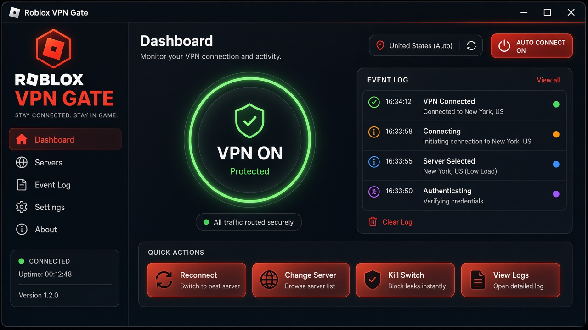
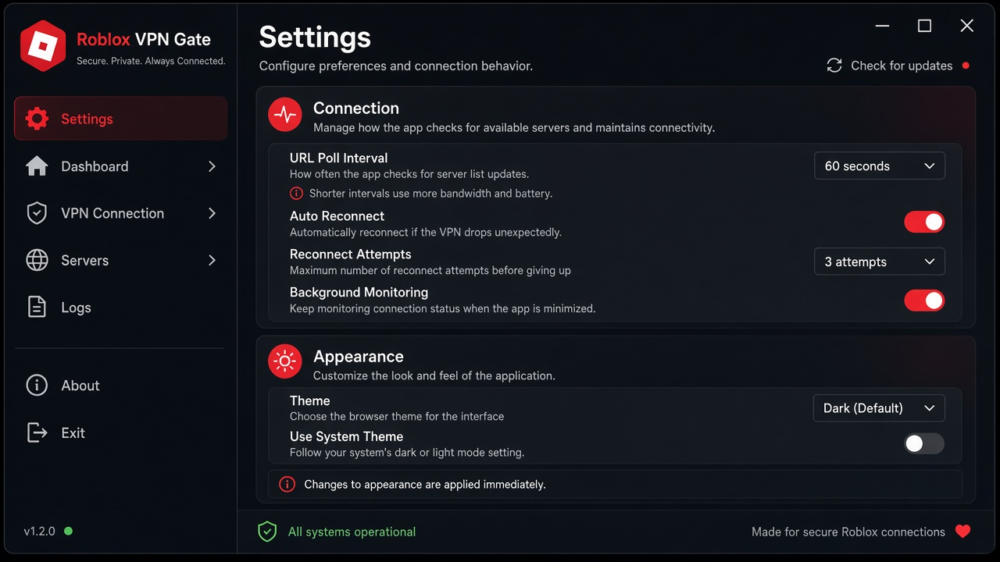

<p align="center">
  
</p>

<p align="center">
  <strong>Roblox VPN Gate</strong> — opens a Roblox tab when a <em>real</em> VPN tunnel connects, and closes it the moment the tunnel drops.<br/>
  Beautiful HTML UI · settings · Windows adapter monitoring
</p>

<p align="center">
  <a href="#-quick-start"></a>
  <a href="README.md"></a>
  
  
  
</p>

<p align="center">
  <a href="README.md">🇷🇺 Русский</a> · <b>🇬🇧 English</b>
</p>

---

## Why this exists

Many automations only check whether a VPN **process** is running.  
Roblox VPN Gate watches whether a **network VPN interface / RAS tunnel** is actually up.

| Event | Action |
| --- | --- |
| VPN adapter becomes `UP` | Opens a tab with your URL (default `roblox.com`) |
| VPN tunnel disconnects | Immediately closes that tab |
| VPN app open, tunnel down | Does nothing |

Works with common tunnels: WireGuard / WinTun, OpenVPN TAP, NordLynx, WARP, Mullvad, corporate RAS (SSTP/L2TP/IKEv2), plus custom keywords.

---

## Screenshots

<p align="center">
  
</p>

<p align="center">
  
</p>

---

## Quick start

### Requirements

- Windows 10 / 11
- Python 3.10+
- Google Chrome **or** Microsoft Edge

### Install

```bat
git clone https://github.com/ZVatnikV/RobloxVPNGate.git
cd RobloxVPNGate
run.bat
```

Or manually:

```bat
py -3 -m venv .venv
.venv\Scripts\activate
pip install -r requirements.txt
python main.py
```

---

## Usage

1. Launch with `run.bat`.
2. Click **Start monitoring** (or enable auto-start in settings).
3. Connect your VPN normally.
4. When the tunnel is active — Roblox opens.
5. Disconnect VPN — the tab closes immediately.

> An already-connected VPN at monitor start does **not** reopen the tab. Only the *offline → online* edge triggers it.

---

## Settings

`settings.json` is created from `settings.default.json`.

| Key | Meaning |
| --- | --- |
| `url` | Site to open |
| `poll_interval_sec` | Adapter poll interval |
| `browser` | `chrome` or `edge` |
| `open_on_connect` / `close_on_disconnect` | Reaction rules |
| `custom_adapter_keywords` / `ignore_adapters` | Detection tuning |
| `theme` / `language` | UI theme and language |

---

## License

MIT

<p align="center">
  <a href="README.md">Открыть русский README</a>
</p>
